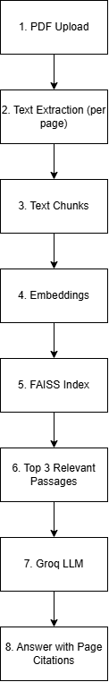

# Architecture (Shirin: extend this and draw a diagram)

1. pdf_processor.extract_pages - PDF bytes -> [{page, text}]
2. text_processor.chunk_pages - cleaned, sentence-aware chunks (1000 chars, 200 overlap), page kept
3. retriever.Retriever - MiniLM embeddings, FAISS inner-product search, top-k chunks with score
4. answerer.answer - prompt restricted to retrieved passages, cites pages, "Not found" fallback
5. app.py - upload, question box, answer, evidence expanders

Why it is "explainable": every answer shows the source passages, page numbers and similarity scores.
