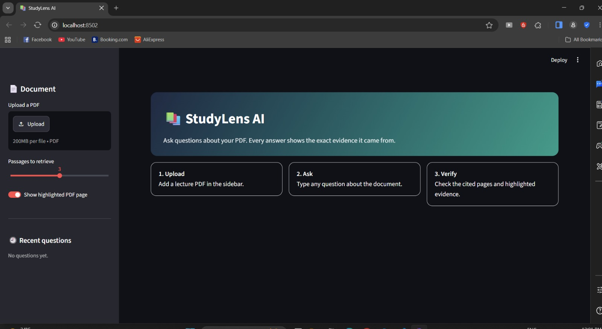
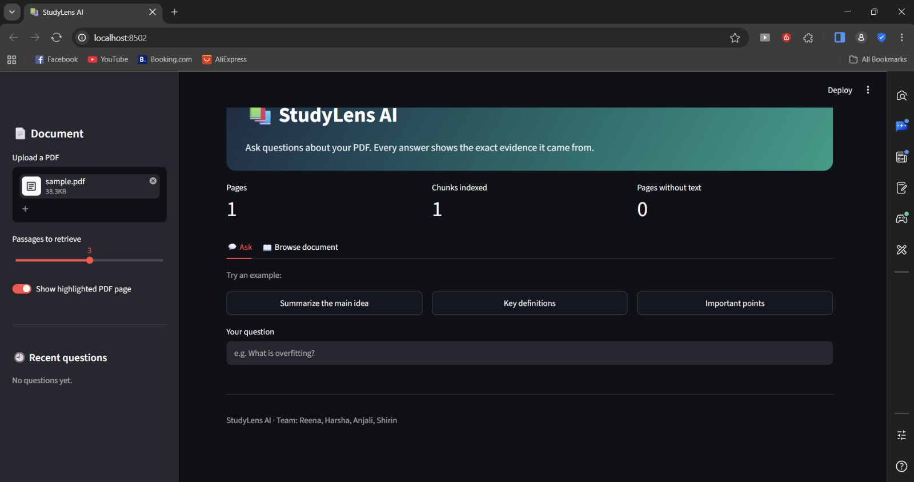
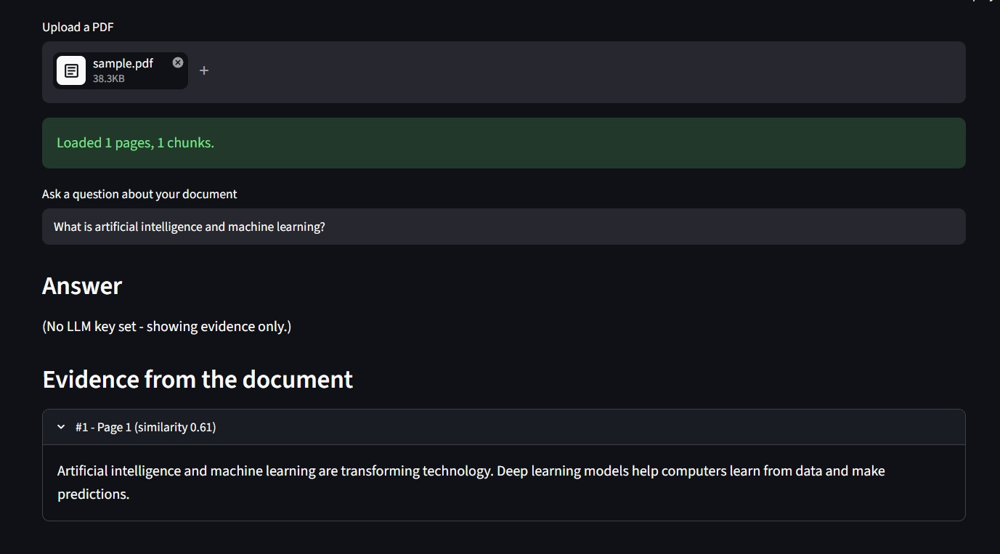

StudyLens AI — User Manual

1. Introduction

StudyLens AI is an Explainable AI Study Assistant designed to answer questions using information from uploaded PDF documents. It helps users find relevant information and view supporting evidence from the document.

2. Installation

1. Install Python on your computer.
2. Clone or download the StudyLens AI project from GitHub.
3. Open the project folder in Visual Studio Code (VS Code).
4. Create and activate a Python virtual environment.
5. Install the dependencies listed in the project's `requirements.txt` file.
6. Create a `.env` file in the project root directory and configure your Groq API key.
7. Run the application using Streamlit.
8. Open the local URL displayed in the terminal to access StudyLens AI.

3. Configure the API Key

1. Create or open the ".env" file in the project folder.
2. Add the API key using the environment variable name required by the project.
3. Save the file.

Important: Never share your API key or include it in screenshots, documentation, or GitHub commits.

4. Run the Application

1. Open the project folder in VS Code.
2. Open the integrated terminal.
3. Activate the virtual environment.
4. Install any missing dependencies, if required.
5. Execute the application using the command `streamlit run app.py`.
6. Upload a PDF document and enter a question to test the application's functionality.

5. Upload a PDF

1. Open the application.
2. Upload a PDF document using the upload option.
3. Wait for the document to be processed.
4. Check whether the application displays the extracted content or document-processing status.

6. Ask a Question

1. Enter a question related to the uploaded PDF.
2. Submit the question.
3. Wait for the application to generate an answer.
4. Read the answer and check the cited page numbers or supporting evidence, if displayed.

7. View Evidence

Review the supporting text and page references provided with the answer. Use them to verify that the response matches the uploaded document.

If the application provides a highlighted PDF page, use it to locate the relevant information quickly.

8. Troubleshooting

No text found

- Check that the PDF contains selectable text.
- Try another text-based PDF.
- Scanned PDFs may require OCR support, which should not be assumed to be available.

API key not working

- Check that the key is valid and has the required permissions.
- Verify the environment variable name expected by the project.
- Ensure the ".env" file is saved in the correct location.
- Never share the key publicly.

First start is slow

- Wait for the application to finish loading its models and dependencies.
- The first run may take longer than later runs.

9. Screenshots

9.1 Main Interface

9.2 PDF Upload

9.3 Question and Answer

